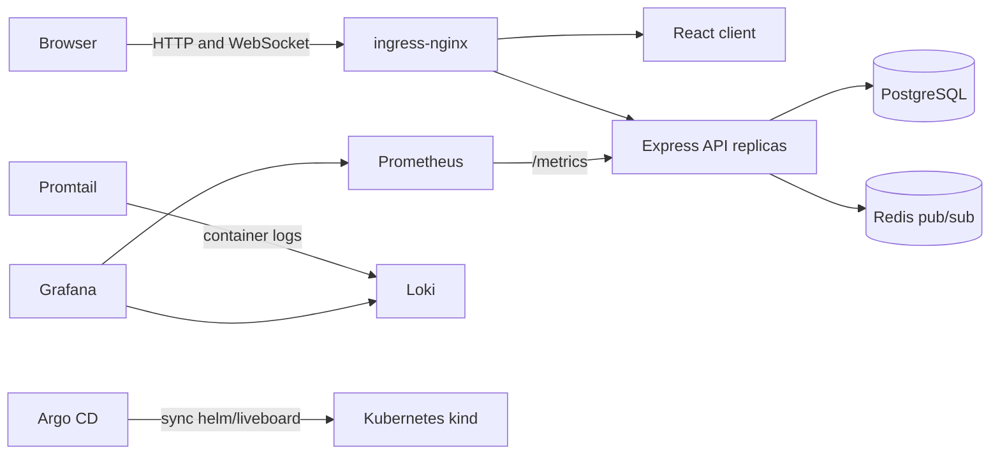

# LiveBoard

LiveBoard is a small real-time Kanban board used to demonstrate an automated delivery and operations workflow. It consists of a React/Vite client, an Express/WebSocket API, PostgreSQL for board data, and Redis pub/sub for events shared between API replicas.

## Architecture



## Repository layout

- `server/` — Express REST API, WebSocket endpoint, readiness/liveness probes, Prometheus metrics, and Jest tests.
- `client/` — React Kanban UI, packaged by Nginx.
- `docker-compose.yml` — local API, client, PostgreSQL, and Redis stack.
- `terraform/` — local kind cluster, ingress-nginx, and Argo CD.
- `helm/liveboard/` — LiveBoard workloads, services, ingress, autoscaling, and optional NetworkPolicies.
- `argocd/application.yaml` — Argo CD app that tracks the Helm chart in Git.
- `observability/` — Prometheus, Grafana, Loki, Promtail, a provisioned dashboard, and an alert rule.
- `k6/liveboard.js` — read-only board API load scenario.

## Local development

Requirements: Node.js 22, npm, Docker Engine or Docker Desktop with Compose.

```sh
cp .env.example .env
docker compose up --build
```

Open <http://localhost>. API probes are at `/healthz` and `/readyz`; Prometheus metrics are at `/metrics`; the board API is at `/api/board`. To run the server suite and build the client:

```sh
npm --prefix server ci
npm --prefix server test
npm --prefix client ci
npm --prefix client run build
```

## kind and GitOps deployment

Terraform creates `liveboard-cluster`, ingress-nginx, and Argo CD. Run Terraform from `terraform/` using the pinned provider versions in `versions.tf`. After applying, the Argo CD UI is available at <http://argocd.local> when that hostname resolves to `127.0.0.1`.

The Argo CD Application in `argocd/application.yaml` watches the `main` branch and syncs `helm/liveboard`. CI builds and publishes images to GHCR; the chart image tags must match tags published by CI before syncing a new app version. The chart currently uses `latest`; for repeatable releases, set both image tags to the same immutable commit SHA in `helm/liveboard/values.yaml` and push the change.

## Observability

The small in-cluster stack uses Prometheus for metrics, Grafana for dashboards, and Loki with Promtail for pod logs. Prometheus scrapes `liveboard-api.liveboard.svc.cluster.local:5000/metrics`. The provisioned **LiveBoard Overview** dashboard charts request rate, p95 API latency, card events, and API scrape health. The `LiveBoardApiUnavailable` alert fires when the API scrape is down for two minutes.

Before applying the stack, set a private Grafana admin password in the cluster. This command prompts without echoing the password and does not write it into Git:

```sh
kubectl create namespace observability --dry-run=client -o yaml | kubectl apply -f -
read -rsp 'Grafana admin password: ' GRAFANA_PASSWORD; echo
kubectl -n observability create secret generic grafana-admin --from-literal=password="$GRAFANA_PASSWORD" --dry-run=client -o yaml | kubectl apply -f -
unset GRAFANA_PASSWORD
kubectl apply -f observability/namespace.yaml
```

Open separate terminals for the UIs:

```sh
kubectl -n observability port-forward svc/grafana 3000:3000
kubectl -n observability port-forward svc/prometheus 9090:9090
```

Grafana is at <http://localhost:3000> (`admin` plus the password you entered). Prometheus is at <http://localhost:9090>. In Grafana, open **Dashboards → LiveBoard → LiveBoard Overview**. To inspect logs, open **Explore**, select Loki, and query `{job="kubernetes-pods"}`.

The manifests use ephemeral storage sized for a local learning cluster; metrics and logs are lost when their pods are recreated. Configure persistent volumes and retention before using this for durable monitoring.

## Network policies

The policies are disabled by default. They restrict LiveBoard pod traffic to the ingress controller, the required app-to-app paths, cluster DNS, and Prometheus scraping. Enable them in `helm/liveboard/values.yaml`:

```yaml
networkPolicies:
  enabled: true
```

Then let Argo CD sync, or run `helm upgrade --install liveboard helm/liveboard -n liveboard`. The cluster CNI must enforce Kubernetes NetworkPolicy (kind's default networking may not enforce these policies); verify enforcement in a disposable cluster before depending on them.

## Load test

Install k6 using its official instructions, then run the read-only API scenario against the local ingress:

```sh
k6 run -e BASE_URL=http://127.0.0.1 k6/liveboard.js
```

The test ramps to 10 virtual users, holds for one minute, and ramps down. It checks for a 200 response and board shape, with thresholds of under 1% failed requests and p95 latency under 500 ms. It does not create or delete cards.

## CI

`.github/workflows/ci.yml` runs on pushes and pull requests. GHCR publishing requires the repository's GitHub Actions package permissions to be enabled. CI should be green before Argo CD deploys a new chart revision.

## Operational notes

- `/healthz` checks process liveness; `/readyz` checks PostgreSQL and Redis connectivity.
- The chart's PostgreSQL password has a development default in `values.yaml`. Set a private override before exposing this deployment beyond a local machine. Never commit a real password or kubeconfig.
- The CI workflow, Terraform apply, cluster image pulls, and ingress access require their corresponding host credentials and local tools.
